<h2 align="center"></h2>

  <picture>
    <source media="(prefers-color-scheme: dark)" srcset="assets/banners/fastfetch-dark.svg">
    <source media="(prefers-color-scheme: light)" srcset="assets/banners/fastfetch-light.svg">
    
  </picture>

<h2 align="center"></h2>

  

<h2 align="center"></h2>

<h3 align="center"></h3>

<h4 align="center"></h4>

  

<h4 align="center"></h4>

  

<h4 align="center"></h4>

  

<h4 align="center"></h4>

  

<h4 align="center"></h4>

  

<h4 align="center"></h4>

  

<h4 align="center"></h4>

  

<h4 align="center"></h4>

  

<h4 align="center"></h4>

  

<h4 align="center"></h4>

  

<h4 align="center"></h4>

  

<h4 align="center"></h4>

  

<h3 align="center"></h3>

<h4 align="center"></h4>

  

<h4 align="center"></h4>

  

<h3 align="center"></h3>

<h4 align="center"></h4>

  

<h3 align="center"></h3>

  

<h2 align="center"></h2>

  
  
  
  
  
  

<h2 align="center"></h2>

  <a href="https://github.com/matezepam?tab=repositories"></a>

  

  

<h2 align="center"></h2>

  
  
  
  <!-- Wrap the LinkedIn image in a link once the profile URL is available. -->
  

<!--
SVG source credits. Product marks belong to their respective owners. The Power BI mark is a simplified local redraw.
Linux penguin ANSI rendering based on the original by Larry Ewing (made in GIMP), vector by Garrett LeSage, refinements by IFo Hancroft. Source: https://github.com/garrett/Tux
Arch Linux ANSI rendering from the Arch Linux logo in Devicon: https://github.com/devicons/devicon/blob/master/icons/archlinux/archlinux-original.svg
EmbroideryStudio e4: local wordmark rendering of the e4 branding. Launch artwork: https://www.prnewswire.com/news-releases/wilcom-international-launches-their-flagship-product-line-embroiderystudio-e4-300435881.html ngspice uses a typographic symbol.
python: https://github.com/devicons/devicon/blob/master/icons/python/python-original.svg
javascript: https://github.com/devicons/devicon/blob/master/icons/javascript/javascript-original.svg
typescript: https://github.com/simple-icons/simple-icons/blob/develop/icons/typescript.svg
java: https://github.com/devicons/devicon/blob/master/icons/java/java-original.svg
kotlin: https://github.com/devicons/devicon/blob/master/icons/kotlin/kotlin-original.svg
rust: https://github.com/devicons/devicon/blob/master/icons/rust/rust-original.svg
react: https://github.com/devicons/devicon/blob/master/icons/react/react-original.svg
vuejs: https://github.com/devicons/devicon/blob/master/icons/vuejs/vuejs-original.svg
angular: https://github.com/devicons/devicon/blob/master/icons/angular/angular-original.svg
nextjs: https://github.com/simple-icons/simple-icons/blob/develop/icons/nextdotjs.svg
tailwindcss: https://github.com/devicons/devicon/blob/master/icons/tailwindcss/tailwindcss-original.svg
bulma: https://github.com/devicons/devicon/blob/master/icons/bulma/bulma-plain.svg
django: https://github.com/devicons/devicon/blob/master/icons/django/django-plain.svg
apache: https://github.com/devicons/devicon/blob/master/icons/apache/apache-original.svg
apachekafka: https://github.com/devicons/devicon/blob/master/icons/apachekafka/apachekafka-original.svg
mysql: https://github.com/devicons/devicon/blob/master/icons/mysql/mysql-original.svg
postgresql: https://github.com/simple-icons/simple-icons/blob/develop/icons/postgresql.svg
mongodb: https://github.com/devicons/devicon/blob/master/icons/mongodb/mongodb-original.svg
supabase: https://github.com/devicons/devicon/blob/master/icons/supabase/supabase-original.svg
dbeaver: https://github.com/devicons/devicon/blob/master/icons/dbeaver/dbeaver-original.svg
aws-alt: https://github.com/gilbarbara/logos/blob/main/logos/aws.svg
docker: https://github.com/devicons/devicon/blob/master/icons/docker/docker-original.svg
podman: https://github.com/devicons/devicon/blob/master/icons/podman/podman-original.svg
render-si: https://github.com/simple-icons/simple-icons/blob/develop/icons/render.svg
vercel: https://github.com/devicons/devicon/blob/master/icons/vercel/vercel-original.svg
git: https://github.com/devicons/devicon/blob/master/icons/git/git-original.svg
github: https://github.com/devicons/devicon/blob/master/icons/github/github-original.svg
linux-simple: https://github.com/simple-icons/simple-icons/blob/develop/icons/linux.svg
archlinux: https://github.com/devicons/devicon/blob/master/icons/archlinux/archlinux-original.svg
omarchy: https://github.com/simple-icons/simple-icons/blob/develop/icons/omarchy.svg
windows11: https://github.com/devicons/devicon/blob/master/icons/windows11/windows11-original.svg
android: https://github.com/devicons/devicon/blob/master/icons/android/android-original.svg
ios: https://github.com/devicons/devicon/blob/master/icons/apple/apple-original.svg
vscode: https://github.com/devicons/devicon/blob/master/icons/vscode/vscode-original.svg
postman: https://github.com/simple-icons/simple-icons/blob/develop/icons/postman.svg
bash: https://github.com/devicons/devicon/blob/master/icons/bash/bash-original.svg
vmware: https://github.com/simple-icons/simple-icons/blob/develop/icons/vmware.svg
word: https://github.com/vscode-icons/vscode-icons/blob/master/icons/file_type_word.svg
excel: https://github.com/vscode-icons/vscode-icons/blob/master/icons/file_type_excel.svg
powerpoint: https://github.com/vscode-icons/vscode-icons/blob/master/icons/file_type_powerpoint.svg
powerbi: https://github.com/gilbarbara/logos/blob/main/logos/microsoft-power-bi.svg
sap: https://github.com/simple-icons/simple-icons/blob/develop/icons/sap.svg
discord: https://github.com/simple-icons/simple-icons/blob/develop/icons/discord.svg
teams: https://github.com/gilbarbara/logos/blob/main/logos/microsoft-teams.svg
mattermost: https://github.com/devicons/devicon/blob/master/icons/mattermost/mattermost-original.svg
zoom-si: https://github.com/simple-icons/simple-icons/blob/develop/icons/zoom.svg
googlemeet-si: https://github.com/simple-icons/simple-icons/blob/develop/icons/googlemeet.svg
qucs-s: https://github.com/ra3xdh/qucs_s/blob/current/qucs/bitmaps/hicolor/scalable/apps/qucs-s.svg
photoshop: https://github.com/devicons/devicon/blob/master/icons/photoshop/photoshop-original.svg
illustrator: https://github.com/devicons/devicon/blob/master/icons/illustrator/illustrator-original.svg
photopea: https://github.com/simple-icons/simple-icons/blob/develop/icons/photopea.svg
wilcom: https://www.g2.com/products/embroiderystudio-e4/reviews
instagram: https://github.com/simple-icons/simple-icons/blob/develop/icons/instagram.svg
tiktok: https://github.com/simple-icons/simple-icons/blob/develop/icons/tiktok.svg
linkedin: https://github.com/devicons/devicon/blob/master/icons/linkedin/linkedin-original.svg

Devicon license:
The MIT License (MIT)

Copyright (c) 2015 konpa

Permission is hereby granted, free of charge, to any person obtaining a copy of
this software and associated documentation files (the "Software"), to deal in
the Software without restriction, including without limitation the rights to
use, copy, modify, merge, publish, distribute, sublicense, and/or sell copies of
the Software, and to permit persons to whom the Software is furnished to do so,
subject to the following conditions:

The above copyright notice and this permission notice shall be included in all
copies or substantial portions of the Software.

THE SOFTWARE IS PROVIDED "AS IS", WITHOUT WARRANTY OF ANY KIND, EXPRESS OR
IMPLIED, INCLUDING BUT NOT LIMITED TO THE WARRANTIES OF MERCHANTABILITY, FITNESS
FOR A PARTICULAR PURPOSE AND NONINFRINGEMENT. IN NO EVENT SHALL THE AUTHORS OR
COPYRIGHT HOLDERS BE LIABLE FOR ANY CLAIM, DAMAGES OR OTHER LIABILITY, WHETHER
IN AN ACTION OF CONTRACT, TORT OR OTHERWISE, ARISING FROM, OUT OF OR IN
CONNECTION WITH THE SOFTWARE OR THE USE OR OTHER DEALINGS IN THE SOFTWARE.

VSCode Icons license:
The MIT License (MIT)

Copyright The vscode-icons Contributors

Permission is hereby granted, free of charge, to any person obtaining a copy
of this software and associated documentation files (the "Software"), to deal
in the Software without restriction, including without limitation the rights
to use, copy, modify, merge, publish, distribute, sublicense, and/or sell
copies of the Software, and to permit persons to whom the Software is
furnished to do so, subject to the following conditions:

The above copyright notice and this permission notice shall be included in all
copies or substantial portions of the Software.

THE SOFTWARE IS PROVIDED "AS IS", WITHOUT WARRANTY OF ANY KIND, EXPRESS OR
IMPLIED, INCLUDING BUT NOT LIMITED TO THE WARRANTIES OF MERCHANTABILITY,
FITNESS FOR A PARTICULAR PURPOSE AND NONINFRINGEMENT. IN NO EVENT SHALL THE
AUTHORS OR COPYRIGHT HOLDERS BE LIABLE FOR ANY CLAIM, DAMAGES OR OTHER
LIABILITY, WHETHER IN AN ACTION OF CONTRACT, TORT OR OTHERWISE, ARISING FROM,
OUT OF OR IN CONNECTION WITH THE SOFTWARE OR THE USE OR OTHER DEALINGS IN THE
SOFTWARE.
-->
